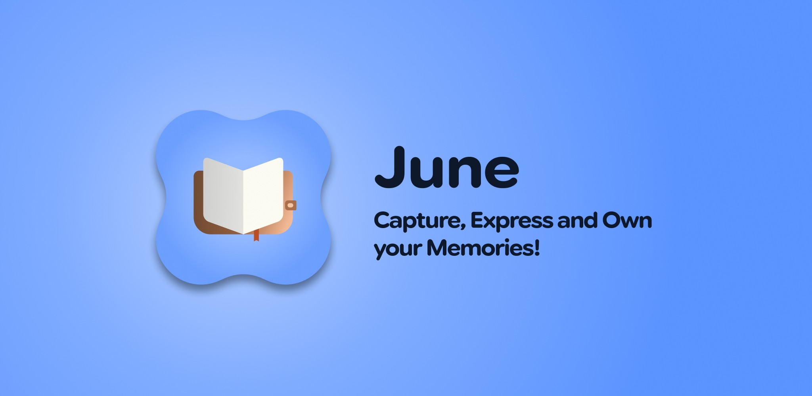
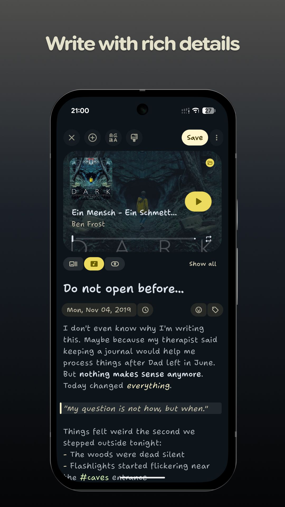
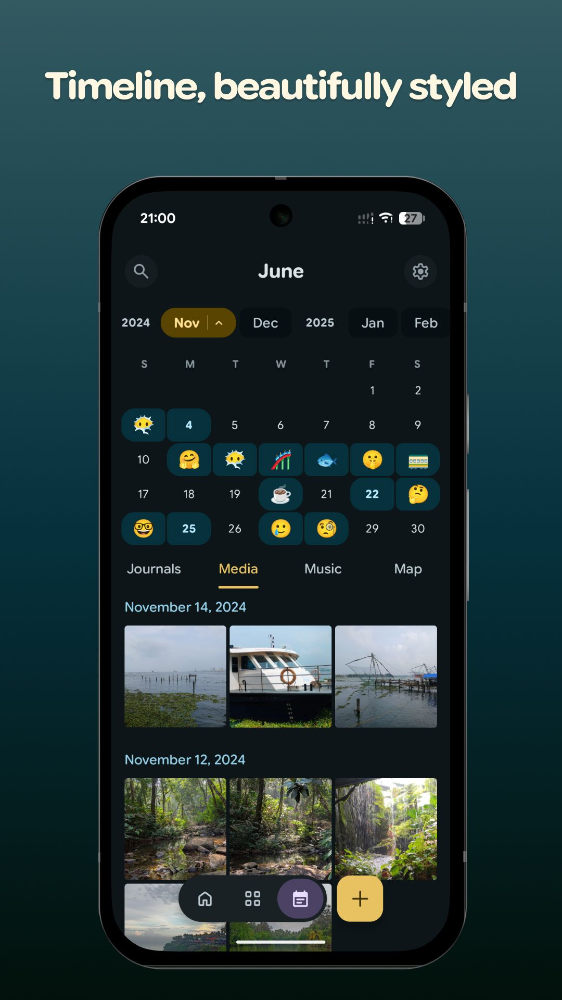
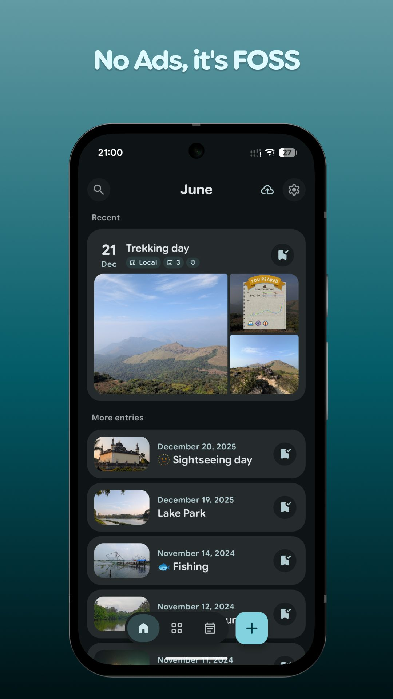
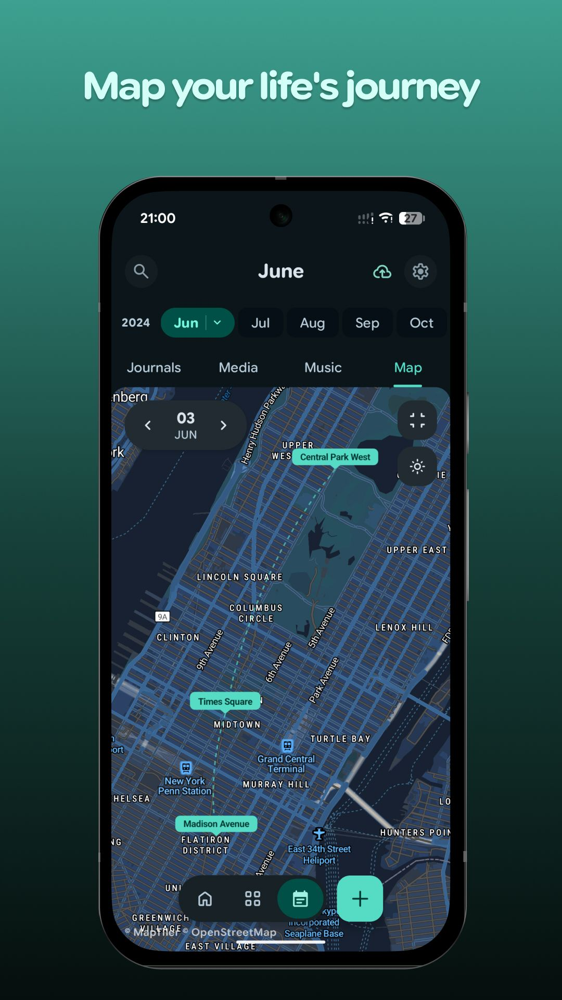
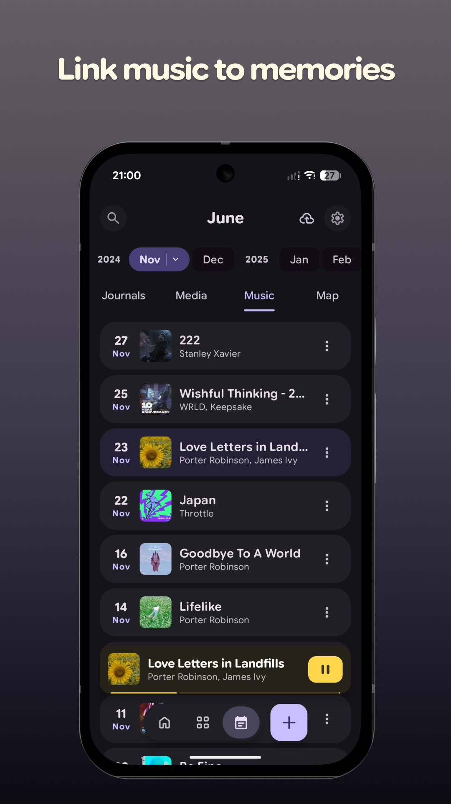
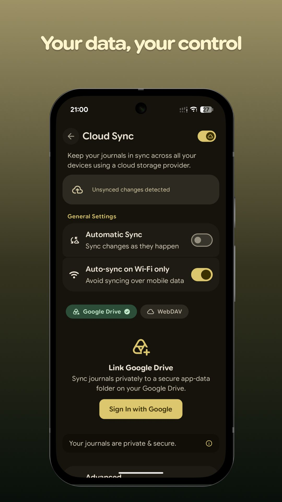
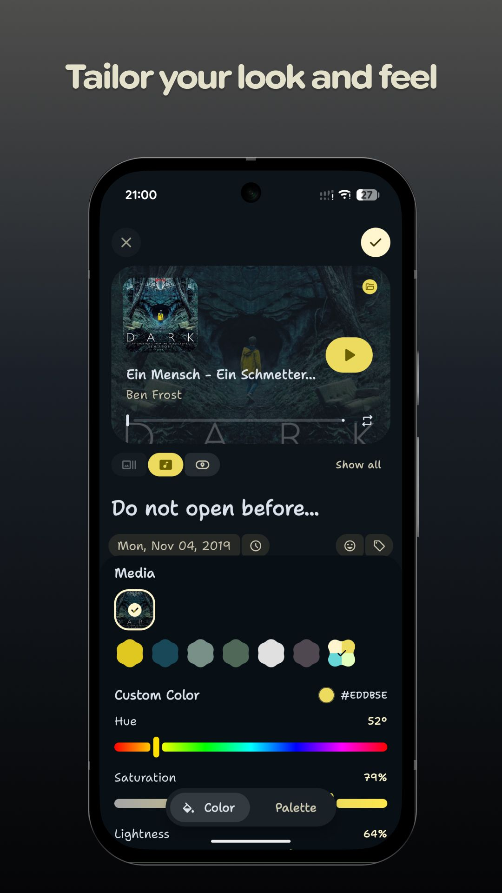
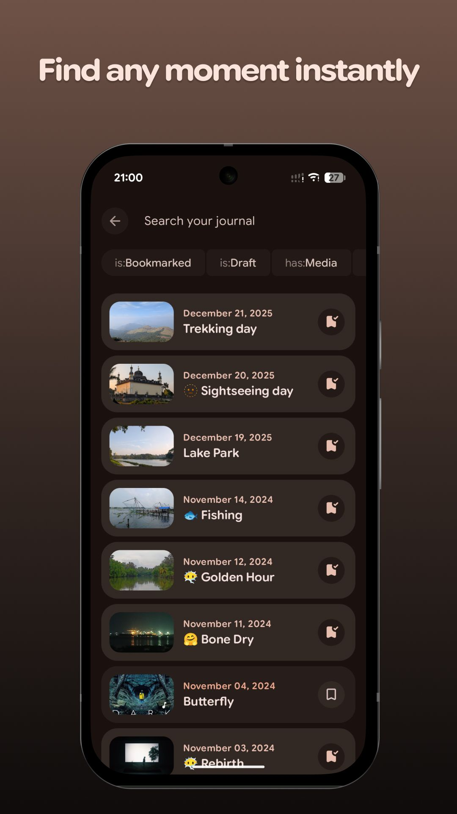

<picture>
  <source srcset="fastlane/metadata/android/en-US/images/banner.jpg">
  
</picture>

<br>

<p align="center">
  <strong>June is an open-source alternative to Pixel Journal</strong><br>
  Built with Jetpack Compose and Material 3 Expressive 
</p>

<p align="center">
    <a href="https://github.com/DenserMeerkat/June/releases/latest">
        
    </a>
    <a href="https://github.com/DenserMeerkat/June/releases">
        
    </a>
    <a href="https://github.com/DenserMeerkat/June/releases">
        
    </a>
    <a href="https://hosted.weblate.org/engage/june/">
        
    </a>
</p>

<p align="center">
  <a href="https://play.google.com/store/apps/details?id=com.denser.june.play">
    
  </a>
  <a href="https://github.com/DenserMeerkat/June/releases/latest">
    
  </a>
</p>

<p align="center">
  
  
  
  
  
  
  
  
</p>

## Features

- **Multimedia Capsules:** Attach photos, videos, and precise locations, complete with full-screen media viewer, EXIF inspection, and built-in compression.
- **Smart Organization:** Categorize entries using three distinct tag groups: Spaces, People (`@`), and Topics (`#`).
- **Soundtracks & Song Library:** Attach streaming music links or import local audio files with built-in waveform scrubbing and trimming.
- **Variable Typography:** Fine-tune bundled variable fonts (Google Sans Flex, Roboto Flex, Recursive, Shantell Sans) with real-time sliders for weight, optical size, and slant.
- **Per-Journal Styling:** Customize individual entry cards with bespoke fonts and extract dynamic color palettes directly from attached photos.
- **Dynamic Map Theming:** Vector map rendering with layer accents that automatically adapt to your Material You theme.
- **Unified Timeline & Streaks:** Navigate past memories through a month-view calendar with writing indicators and consistency streaks.
- **Rich Text & Markdown:** Format text with bold, italics, highlights, blockquotes, checklists, and full Markdown import/export.
- **Mood Tracking:** Log emotional journeys using a built-in searchable emoji picker.
- **Cloud Sync & Privacy:** 100% offline-first architecture with optional end-to-end sync via WebDAV or Google Drive.
- **Private Vault & App Lock:** Keep sensitive entries hidden in an isolated vault protected by Biometrics, PIN, Password, or Pattern.

## Translations

June is localized by community contributors on [Hosted Weblate](https://hosted.weblate.org/engage/june/). Contributions and language additions are always welcome.

<p align="center">
  <a href="https://hosted.weblate.org/engage/june/">
    
  </a>
</p>

<p align="center">
  <a href="https://hosted.weblate.org/engage/june/">
    
  </a>
</p>

## Credits

- Kotlin and Jetpack Compose 🖤
- [MaterialKolor](https://github.com/jordond/MaterialKolor)
- [MapLibre SDK](https://maplibre.org/)
- [Telephoto](https://github.com/saket/telephoto)
- [Coil](https://coil-kt.github.io/coil/)
- [Media3 (ExoPlayer)](https://developer.android.com/media/media3)
- [Wavy Slider](https://github.com/mahozad/wavy-slider)
- [Koin](https://insert-koin.io/)
- Maps & Tiles: [OpenStreetMap](https://www.openstreetmap.org/), [OpenFreeMap](https://openfreemap.org/), [CARTO](https://carto.com/), [MapTiler](https://www.maptiler.com/), [Stadia Maps](https://stadiamaps.com/)
- Fonts: [Google Sans Flex](https://github.com/google/fonts), [Roboto Flex](https://github.com/googlefonts/roboto-flex), [Recursive](https://www.recursive.design/), [Shantell Sans](https://shantellsans.com/)

## Security & Verification

- **Signing Certificate (GitHub Releases):**
  ```
  E8:21:01:FC:C2:20:98:61:AF:DF:81:1C:03:12:F6:2A:A5:BA:8B:E3:10:E1:D2:74:C6:91:CE:6E:B5:D1:B7:BB
  ```
- **Artifact Attestations:** Official GitHub releases are cryptographically signed and verifiable via the [Attestations Dashboard](https://github.com/DenserMeerkat/June/attestations) or the GitHub CLI:
  ```bash
  gh attestation verify <apk-filename>.apk --repo DenserMeerkat/June
  ```

---

<p align="center">
  <a href="https://densermeerkat.github.io/June/PRIVACY">Privacy Policy</a> • <a href="LICENSE">License</a>
</p>
